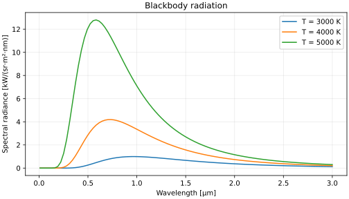

# unitx

[](https://pypi.org/project/unitx/)
[](https://pypi.org/project/unitx/)
[](https://github.com/DaitTHU/unitx/blob/main/LICENSE)

Write physical formulas with units and constants in Python.
`unitx` keeps unit scales and rational powers exact. It checks dimensions at
runtime and provides type hints for magnitudes. Use it for scalar quantities,
temperature and logarithmic readings, and optional NumPy arrays.

## Install

Requires Python **3.12 or later**. The base package has no runtime dependencies.

```sh
pip install unitx
```

## Calculate with units

Use `si` for units and `SI` for physical constants. For example, `si.c` is a
speed unit and `SI.c` is the speed of light as a quantity.

```pycon
>>> from unitx.si import SI, si
>>> distance = 3 * si.m
>>> duration = 2 * si.s
>>> speed = distance / duration
>>> print(speed)
1.5 m/s
>>> print(speed.to(si.cm / si.s))
150.0 cm/s
>>> rest_energy = (SI.me * SI.c**2).to(si.MeV)
>>> print(round(rest_energy.value, 6))
0.510999

```

Addition aligns compatible units. Multiplication, division and powers combine
units. A conversion between incompatible dimensions raises `DimensionError`.

```pycon
>>> distance.to(si.s)
Traceback (most recent call last):
    ...
unitx.exceptions.DimensionError: Cannot convert quantity with dimension L to unit with incompatible algebraic dimension T.

```

## Temperatures and logarithmic readings

Use `@` for an absolute reading and `*` for a difference.

```pycon
>>> difference = 20 * si.degC  # A temperature difference of 20 degrees
>>> room = 20 @ si.degC  # A reading of 20 degrees Celsius
>>> difference.value_in(si.K)
20
>>> print(room + 5 * si.K)
25 °C
>>> (30 @ si.degC) - room == 10 * si.K
True
>>> (30 @ si.dBm).to_quantity(si.W) == 1 * si.W
True

```

Subtracting two points gives a difference. Adding two points raises
`TypeError`. See [points and differences](https://github.com/DaitTHU/unitx/blob/main/docs/affine.md)
and [logarithmic quantities](https://github.com/DaitTHU/unitx/blob/main/docs/logarithmic.md).

## Blackbody radiation



Run `pip install 'unitx[matplotlib]'` to try this example. NumPy broadcasts the
wavelength column against three temperatures in Planck's formula. The plot
uses the numerical values in the chosen display units.

```python
import numpy as np
from matplotlib import pyplot as plt

from unitx.si import SI, si

wavelength = np.linspace(0.01, 3, 100)[:, None] * si.um
temperature = np.asarray([3000, 4000, 5000]) * si.K
exponent = SI.h * SI.c / (wavelength * SI.kB * temperature)
radiance = 2 * SI.h * SI.c**2 / (wavelength**5 * np.expm1(exponent))
radiance = radiance.to('kW/sr/m2/nm')

fig, ax = plt.subplots(figsize=(7, 4), layout='constrained')
ax.plot(wavelength.value, radiance.value)
ax.set(
    xlabel=f'Wavelength [{wavelength.unit}]',
    ylabel=f'Spectral radiance [{radiance.unit}]',
    title='Blackbody radiation',
)
ax.legend([f'T = {value}' for value in temperature], framealpha=1)
ax.grid(True, alpha=0.25)
plt.show()
```

For automatic axis conversion with `ax.plot(t, q)`, see the
[Matplotlib adapter](https://github.com/DaitTHU/unitx/blob/main/docs/matplotlib.md).

## Scalar results and comparisons

True division of two Python integers gives a float, as in the speed example.
When unit alignment requires a rational scale, integer magnitudes can yield
a `Fraction`. Use float magnitudes for floating-point calculations.

```pycon
>>> from unitx import Quantity
>>> print(Quantity(1, 'm') + Quantity(50, 'cm'))
3/2 m
>>> print(Quantity(1.0, 'm') + Quantity(50, 'cm'))
1.5 m
>>> Quantity(1, 'm') == Quantity(100, 'cm')
True
>>> a, b = Quantity(0.1, 'm'), Quantity(10, 'cm')
>>> a == b
False
>>> a.isclose(b)
True

```

Exact scalar comparison uses the stored binary value of a float, so `0.1`
metres differs from exactly one tenth of a metre. Use `.isclose()` when a
tolerance is appropriate. See [scalar numerical behavior](https://github.com/DaitTHU/unitx/blob/main/docs/scalars.md)
for result types, Decimal arithmetic and tolerances.

Strings passed to `Quantity` and `.to()` use the default registry, where
`MB` means megabel. For megabytes, pass `information.MB` or
`information.unit('MB')` from the [information catalogue](https://github.com/DaitTHU/unitx/blob/main/docs/catalogues/information.md).

## Work with NumPy

Array support requires NumPy **2.1 or later**. Install both packages with
`pip install 'unitx[numpy]'`. One Quantity wraps a whole array with one unit.

```python
import numpy as np

from unitx import Quantity
from unitx.si import si

positions = Quantity(np.array([1.0, 2.0, 3.0]), si.m)
velocity = positions / (2 * si.s)
mean_velocity = np.mean(velocity)
assert mean_velocity == 1 * si.m / si.s
np.testing.assert_allclose(velocity.value_in(si.cm / si.s), [50, 100, 150])
```

NumPy handles broadcasting, dtypes and rounding. unitx checks and combines
units, and comparisons return boolean masks. See the
[NumPy support matrix](https://github.com/DaitTHU/unitx/blob/main/docs/numpy.md).

`.value` gives the magnitude in the stored unit, and `.value_in(unit)`
converts before returning the magnitude. Use either to pass plain numerical
values to another library. `np.asarray(quantity)` and `np.array(quantity)`
raise `TypeError` to prevent implicit unit removal.

## Read more

Start at the [documentation site](https://daitthu.github.io/unitx/),
or go directly to a topic:

| Topic | Guide |
| --- | --- |
| Construction, arithmetic, conversion and unit expressions | [Units and quantities](https://github.com/DaitTHU/unitx/blob/main/docs/units.md) |
| Ready-to-use units, constants and spelling conventions | [Catalogue](https://github.com/DaitTHU/unitx/blob/main/docs/catalogues/README.md) |
| Custom definitions and cross-process restoration | [Custom units](https://github.com/DaitTHU/unitx/blob/main/docs/custom-units.md) and [serialization](https://github.com/DaitTHU/unitx/blob/main/docs/serialization.md#registry-requirements) |
| Unit-aware math, statistics and clock readings | [Standard-library enhancements](https://github.com/DaitTHU/unitx/blob/main/docs/stdlib.md) |
| Notebook, text, LaTeX, HTML and siunitx output | [Display and formatting](https://github.com/DaitTHU/unitx/blob/main/docs/display.md) |
| Magnitude types and NumPy inference | [Typing](https://github.com/DaitTHU/unitx/blob/main/docs/typing.md) |
| Fitting, wave packets and measurement uncertainty | [Scientific examples](https://github.com/DaitTHU/unitx/blob/main/examples/README.md) |
| Responsibilities, dependencies and measured costs | [Architecture](https://github.com/DaitTHU/unitx/blob/main/docs/architecture.md) and [performance](https://github.com/DaitTHU/unitx/blob/main/benchmarks/performance.md) |
| Version changes | [Migration](https://github.com/DaitTHU/unitx/blob/main/docs/migration.md) and [changelog](https://github.com/DaitTHU/unitx/blob/main/CHANGELOG.md) |

This README describes the current source tree. Public APIs may change during
the 0.x series; consult a release's matching tag for its documentation.
Development and release checks are described in the
[contributing guide](https://github.com/DaitTHU/unitx/blob/main/CONTRIBUTING.md).

Licensed under the [MIT License](https://github.com/DaitTHU/unitx/blob/main/LICENSE).
