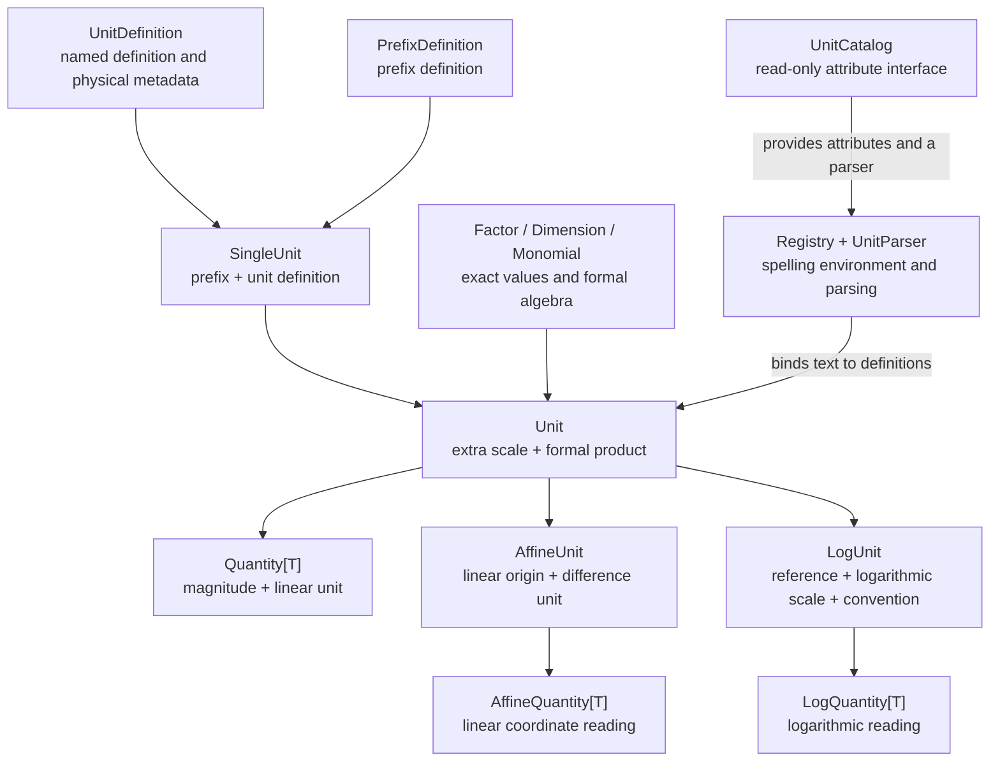

# Custom units and explicit registration

Define a multiplicative unit from an existing Unit, exact scale or positive
finite scalar Quantity. `.define()` creates a named unit with its own formal
identity. **Only an explicit definition block registers spellings immediately.**
UnitCatalog collects public unit attributes after its class body finishes.
Absolute coordinate definitions follow the same rule; see the
[AffineUnit API](affine.md#defining-coordinates).

```pycon
>>> from unitx import Quantity, Registry, Unit, UnitCatalog
>>> from unitx.si import si
>>> newton = Unit('kg*m/s2').define('demoN', 'demo newton')
>>> minute = (60 * si.s).define('demoMin', 'demo minute', prefixable=False)
>>> Quantity(2, minute).value_in(si.s)
120
>>> Quantity(1, si.kN).value_in(newton)
1000

```

These units are immediately usable as objects. Independent definitions may
have identical symbols without colliding. Two such Unit objects remain
formally distinct, while physically compatible quantities can interact.

## Model and responsibilities

The main objects separate unit meaning, spelling lookup and persistence:



`UnitDefinition` owns the unit's semantic facts. `Registry` decides which
spellings resolve in one environment; it does not change a definition's meaning.
`UnitCatalog` groups public unit objects and their parser. Reconstruction uses
stable locations to find existing definitions and checks their saved meaning;
it does not create or register replacement definitions.

`UnitDefinition` is valid as soon as construction succeeds: it checks its own
spellings, prefix permissions and conversion metadata without a Registry.
Import this low-level record and `PrefixPolicy` from `unitx.unitdefinition`.
Registry owns all spelling indexes and checks only conflicts with its current
bindings. Prefix specifications are shared immutable data, independent of
definitions and parsing environments.

Coordinates retain a complete unit product for both their physical reference and
their difference scale, including any extra exact factor. Catalogue construction
first collects its explicit units and public attributes, then binds them in one
call, and finally publishes reconstruction locations. Definitions already in a
shared Registry are not implicitly published by an unrelated catalogue.

## Independent registries

Most users can use built-in catalogues directly. A Registry is an explicit
spelling environment for private definitions or a file format:

Defining a unit and binding its spellings are separate steps. `.define()` checks
the definition's own spellings and returns a usable Unit object. A Registry then
checks those spellings against its existing bindings before adding them; a
conflict leaves that Registry unchanged.

```pycon
>>> private = Registry([si.m, si.s])
>>> with private.defining():
...     span = (2 * si.m).define('span', 'survey span', 'survey distance')
...     speed = (span / si.s).define('spanrate', 'survey speed')
>>> private.parse('[survey span] / s') == span / si.s
True
>>> private.parse('kilosurvey distance') == private.parse('kspan')
True
>>> Quantity(3, span).value_in(si.m)
6
>>> other = Registry()
>>> another_span = other.define(2 * si.m, 'span', 'survey span', 'survey distance')
>>> span == another_span
False
>>> 1 * span == 1 * another_span
True

```

`Registry()` starts with only the multiplicative identity. Its constructor and
`include(*units)` share existing definitions, preserving identity, aliases and
prefix permissions. Named AffineUnit objects also bring their bound reference
and difference definitions. Including an already included definition is harmless.
An entire `include()` call validates before updating the receiving indexes.
For example, `private.include(si.m, si.s)` includes both units in one batch.

`Registry.define(source, symbol, name, ...)` is a convenience for one linear
Unit or positive real Quantity: it creates and binds using that explicit target,
even inside another definition block or catalogue's class body. To bind an existing definition
without creating a new identity, use `registry.include(unit)`.

Select shared definitions before adding private spellings that conflict with
them. For example, an environment can bind `B` to byte by omitting SI bel and
calling `registry.define(Unit(), 'B', 'byte')`. There is no fallback from a private
registry to the default table, and parsing never guesses from a source dimension.

## Explicit definition blocks

Use `with registry.defining():` to define several related units in ordinary
Python code. No class declaration is required. `as` optionally returns the
same Registry, which remains usable after the block exits:

```pycon
>>> from unitx import AffineUnit
>>> with Registry([si.K]).defining() as thermal:
...     step = (2 * si.K).define('demoStep', 'demo temperature step')
...     reading = AffineUnit(10 * si.K, delta_unit=step).define('demoReading', 'demo reading')
>>> thermal.parse('demoStep/K') == step / si.K
True
>>> (3 @ reading).value_in(si.K)
Fraction(16, 1)

```

Unit, Quantity, AffineUnit and LogUnit `.define()` calls, including helper calls, use the
selected environment. Existing objects are included with `registry.include()`;
assigning a local variable does not create a Registry attribute.

Nested definition blocks restore the outer target on exit, including exceptions.
The innermost explicit block takes precedence, including while a class body
is executing. An explicit `other_registry.define(...)` always writes to its named target.
Successfully registered definitions remain after an exception; the block selects
an environment rather than providing a transaction. An individual failed
registration leaves spelling indexes unchanged.

Each new definition in an ordinary block has its own identity. To share one
between registries, include the existing unit object. Definitions do not accept
user-assigned identity strings.

Only definition construction consults the scope. Bare `Unit('m')`,
`Quantity(3, 'm')` and `.to('cm')` always use the default environment. A private
unit expression must be parsed with `registry.parse()` or `catalogue.unit()`;
when defining one unit from another, use its bound Unit object directly.

Explicit block selection follows ContextVar semantics: asyncio tasks inherit
context at creation and can outlive the parent's block. Changes in one task do
not select a registry for another task. Context isolation does not synchronize
access to a shared Registry; the concurrent-use contract below still applies.

## Concurrent use and read-only access

A fully initialized Registry supports concurrent `parse()` calls while its
bindings remain unchanged. Finish catalogue imports and registration before
sharing the registry with worker threads. Each call creates its own UnitParser;
callers using UnitParser directly must use separate instances or synchronize
access to a shared parser's mutable parsing state.

```pycon
>>> from concurrent.futures import ThreadPoolExecutor
>>> shared = Registry([si.m, si.s])
>>> with ThreadPoolExecutor(max_workers=2) as workers:
...     parsed = list(workers.map(shared.parse, ('m/s', 'km/s')))
>>> parsed == [si.m / si.s, si.km / si.s]
True

```

Registry provides no internal locking. If registration can overlap other uses,
the application must synchronize every writer and every reader of that registry,
covering each complete registration or parse call with the same lock. This
includes `include()`, `define()`, definitions inside `defining()` and catalogue
collection into a shared registry. A failed registration leaves the bindings
unchanged, but this guarantee does not make a successful update atomically
visible to concurrent readers. A `defining()` block neither holds a lock nor
commits all its definitions as one transaction.

There is no public freeze or read-only snapshot API. Read-only use is an
application discipline. UnitCatalog prevents rebinding its attributes; it does
not freeze its associated Registry. With `registry=shared`, later registrations
in `shared` are also visible through the catalogue's `unit()` method.
`Registry([unit, ...])` creates independent bindings for explicitly supplied
definitions, retaining their identities, aliases and prefix policies; it does
not copy an entire registry or disable future registration. Already constructed
Unit objects retain their definitions when either registry is extended.

## Catalogue class bodies

Catalogue maintainers can use `class example(UnitCatalog):` to collect a read-only
namespace and parser in one level of indentation. The body runs as ordinary
Python code; after it finishes, public Unit and named AffineUnit/LogUnit attributes are
included together. Helper results are collected when assigned to public attributes;
unexported temporary definitions are not collected. Private attributes are ignored.

New spellings are unavailable during the body. Build later units from earlier
objects, such as `(2 * span).define('doubleSpan')`. Bare strings continue to use
the default parser. An explicit `with registry.defining():` still applies to every
call within its ordinary block extent, including calls inside a class body.
Collection does not override that block or undo its completed registrations.

A failed class body does not reach collection. A collection conflict leaves the
receiving Registry unchanged. Neither case installs an implicit definition scope.
See [defining a catalogue](#defining-a-catalogue) for declaration and identity rules.

## Explicitly extending the default environment

Advanced applications can opt into shared default spellings:

```pycon
>>> from unitx.unitregistry import default_registry
>>> interval = default_registry.define(7 * si.s, 'demoInterval', 'demo interval', prefixable=False)
>>> Unit('demoInterval') == interval
True

```

Alternatively create a standalone unit and call `default_registry.include(unit)`.
The default environment starts with the agreed built-in SI catalogue; ordinary
`.define()` calls and extra catalogue imports do not extend it implicitly.

## Exact extra scales

Multiplying or dividing a Unit by a Factor or SymbolicConstant creates a
Unit. Its `scale` is relative to the formal unit product; its `factor`
includes both. A scale of one compares equal to the corresponding Unit and
has the same hash. Unit multiplication, division and powers involving a
Unit retain that type even when the scale cancels to one.

```pycon
>>> from unitx.factor import pi
>>> degree = ((pi / 180) * Unit()).define('demoDeg', 'demo degree', prefixable=False)
>>> degree.factor == pi / 180
True

```

Calling `.define()` returns an ordinary Unit with its own identity, sharing
the total dimension and SI factor. Copying and pickling preserve the formal
units and extra scale; see [reconstruction](#reconstruction-and-exchange).

## Definition signature and spellings

The symbol is positional-only. The optional primary `name` accepts positional or keyword
input and defaults to the symbol. Additional name aliases are optional positional arguments after `name`.
Pass the primary name positionally when supplying aliases. `symbol_aliases`
accepts a string or tuple of strings; it and `prefixable` are keyword-only.
The primary name is optional and defaults to the symbol, so `.define('twip')`
suffices when both spellings are the same.

Symbols and symbol aliases must be single printable unit tokens. Names and name
aliases may contain tokens separated by single ASCII spaces or hyphens, without
leading or trailing separators. Decimal digits and parser operators are invalid.
The primary symbol and any explicitly supplied name must be nonempty; empty aliases are ignored. Square
brackets and superscript characters `⁰¹²³⁴⁵⁶⁷⁸⁹⁺⁻` are reserved for parser syntax.

A complete registered multiword name is recognized before parsing a product.
Within expressions, use `[survey span] / s` or the unit's symbol. A definition
may not give its own aliases conflicting prefix meanings. When binding to a
registry, its texts must also avoid every existing meaning, including generated
prefixes and implicit products such as `metre second`.

Quantity definitions require positive finite int, Fraction, Decimal or float
magnitudes. Fraction and Decimal scales stay exact. Float input follows Factor's
denominator limit and can warn or round to zero and fail, for example at `1e-10`.
Defining a unit never evaluates symbolic scales numerically.

## Prefix permissions

Omitting `prefixable` uses the defining registry's default, or True outside a
block. `Registry(prefixable=False)` disables prefixes for definitions constructed
inside its `defining()` block or through its `define()` method. Catalogue collection
preserves the policy already stored in each definition. Included SI units retain
their original permissions. An explicit per-definition
policy overrides the default. `prefixable` has the following forms:

| Value | Permission |
| --- | --- |
| `True` (default) | Decimal SI prefixes on every spelling |
| `False` | No prefixes |
| `PrefixFamily.DECIMAL`, `.BINARY`, `.ALL` | The selected prefix family on every spelling |
| A spelling string or tuple of spellings | Decimal prefixes on only those spellings |
| A mapping from spellings to `True` or a `PrefixFamily` | The selected family on each listed spelling; others accept no prefixes |

Import `PrefixFamily` and the annotation alias `PrefixPolicy` from
`unitx.unitdefinition`. Enum members cannot be confused with spelling strings.
An empty tuple or mapping disables prefixes. Mapping values are `True` (decimal)
or a `PrefixFamily`, not strings or `False`. Omit a spelling to disable its
prefixes. Unknown spellings and invalid rules are errors. Definitions copy the
mapping into a read-only view; later changes to the input cannot change parsing.
This policy belongs to the immutable definition, whether or not it has been bound
to a parser. `Registry(prefixable=PrefixFamily.BINARY)` can supply a family default
for new definitions; included definitions keep their original policies.

```pycon
>>> from unitx.unitdefinition import PrefixFamily
>>> data = Registry()
>>> octet = data.define(8 * si.one, 'octet', prefixable=PrefixFamily.ALL)
>>> (1 * data.parse('Kioctet')).value_in(octet)
1024
>>> (1 * data.parse('koctet')).value_in(octet)
1000

```

Binary prefixes are Ki, Mi, Gi, Ti, Pi, Ei, Zi, Yi, Ri and Qi, with factors
`2**10` through `2**100`. Ordinary SI units retain decimal-only permissions:
`Kim` is invalid. Prefixes never stack. The separate
[information catalogue](catalogues/information.md) enables both families for bit
and byte, without changing the default meanings of B (bel) or b (barn).

```pycon
>>> ticks = Registry([si.s])
>>> tick = ticks.define(
...     si.s,
...     'demoTick',
...     'survey interval',
...     symbol_aliases='demoT',
...     prefixable=('demoT', 'survey interval'),
... )
>>> ticks.parse('[millisurvey interval]') == ticks.parse('mdemoT')
True
>>> Quantity(1000, ticks.parse('mdemoT')).value_in(tick)
Fraction(1, 1)
>>> ticks.parse('mdemoT').expression()
'mdemoT'

```

Permissions are checked on the spelling before alias normalization. Preferred
output uses the first permitted symbol; if only a name permits the prefix,
`expression()` emits a `[name]` reference. Prefix names attach to the first word,
for example `kilosurvey interval`; a separated `kilo survey interval` is invalid.
`SingleUnit.name` falls back to a symbol when no name permits that prefix.
`PrefixPolicy` is available from `unitx.unitdefinition` for annotations.

## Defining a catalogue

A catalogue combines a read-only namespace with its own parser:

```pycon
>>> from typing import Final
>>> class laboratory(UnitCatalog, units=(si.m,)):
...     span: Final = (2 * si.m).define('span', 'laboratory span')
...     double_span: Final = (2 * span).define('doubleSpan', 'double span')
>>> laboratory.unit('span/m') == laboratory.span / si.m
True
>>> (1 * laboratory.double_span).value_in(si.m)
4

```

`UnitCatalog` supplies namespace immutability, collection, and `unit()`.
Its class body exposes unit objects as attributes. Use Final
annotations on published attributes for static rebinding diagnostics.

- `units=` shares existing definitions alongside public unit attributes, after the
  body finishes. `metre = si.m` also includes the existing definition; Python
  attribute names do not become parser aliases. Use `symbol_aliases=` when needed.
- Each class starts with a fresh environment. Inherited attributes are available
  normally, but parser bindings are not inherited. Use `registry=` when a
  catalogue deliberately shares an existing Registry; SI uses the default one.
- Prefix permissions are fixed during `.define()`. Imperial and US catalogue
  maintainers use explicit `Registry(prefixable=False).defining()` blocks with
  the catalogue's receiving registry. The collector does not change metadata
  or infer policies from class names.
- Definitions use shared immutable objects as formal identities. Including an
  existing unit preserves its identity. Module-level catalogue declarations
  supply structured persistence locations with separate module, catalogue and
  symbol fields. Moving or renaming a published catalogue changes its location.
  No public identity namespace or per-definition ID is needed.

Independent definitions remain distinct each time a declaration executes,
including when reloading the same module-level catalogue. They do not become the same unit merely because
their class names or symbols match. Identity and hashing are final before
`.define()` returns, including inside a class body.

## Reconstruction and exchange

`expression()` describes a formal product in an environment that includes its
definitions. It does not choose a receiving parser or include a Unit's extra
scale. Default-resolvable units keep their familiar repr. Standalone and private
units use an internal identity-based repr requiring their definitions to be loaded.
Repr is a Python diagnostic format, not a portable interchange protocol.
Coordinate and point reprs use a spelling shorthand only when the default
environment resolves it to the same coordinate. A private coordinate may share
a spelling with a default linear or logarithmic unit; its repr then uses the
loaded definition's identity rather than reinterpreting that spelling.

Pickle first resolves the live UUID handle, then a structured catalogue location
when loading in another process. It checks saved immutable metadata recursively,
including coordinate references and difference definitions. It never creates
definitions, merges independently constructed objects, or binds spellings. Import
the same module-level catalogue declarations before unpickling in another process.
Definitions without a published module-level catalogue location, including units
kept only in ordinary blocks or local classes, have process-local locators and
cannot be recreated by repeating the same spelling. Pickles from older unitx
formats are unsupported; load them with the matching older release and recreate
the values with the current API.

JSON format 2 also checks the explicit receiving environment. See
[serialization](serialization.md#registry-requirements) for receiver examples.
Unknown or mismatched definitions fail instead of being registered automatically.
Neither format exports a self-contained set of custom definitions. The
application supplies shared definition objects within a process, or compatible
module-level catalogue declarations in each process.

## Low-level definitions

`UnitDefinition` is the immutable registry record. Its ordinary constructor is
`UnitDefinition(symbol, name=None, *name_aliases, factor=one,
dimension=DIMENSIONLESS, symbol_aliases=(), prefixable=True)`.
The object itself supplies formal identity; its spelling and physical scale do
not determine equality. Copying preserves that object. Registry indexes and
coordinate views derive from its stored data.

Use `Unit.define()` or `Quantity.define()` to derive conversion metadata from
an existing unit, and `AffineUnit.define()` or `LogUnit.define()` for a coordinate. Their internal
constructors preserve logarithmic degree and bound coordinate data automatically.
The ordinary constructor does not expose `logarithmic`, `log_degree`, `reference`,
`delta`, `kind`, or persistent identity options.

[Documentation index](README.md) · [Units and quantities](units.md) ·
[SI spelling conventions](catalogues/si.md#spelling-and-scale-conventions)
